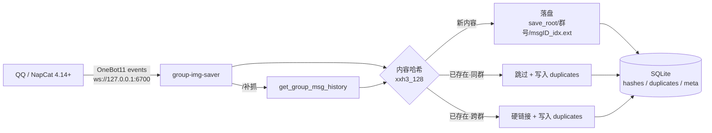

# group-img-saver

按群号归档 QQ 群聊图片的独立服务。以 OneBot 11 客户端身份直连 [NapCat](https://napcat.napneko.icu/)，**不依赖任何机器人框架**（AstrBot/Koishi/NoneBot 等），把指定群的图片以原图保存到 `<保存目录>/<群号>/`，并支持 `/补抓` 回溯 QQ 缓存内的历史图片。

内容哈希去重（默认 xxh3_128，15 GB/s 级），重复图片只存一份、跨群用硬链接补齐，被跳过的副本全部登记到 SQLite 台账。

---

## 特性

- **独立进程**：只要 NapCat 暴露 OneBot WS，本服务即可工作；不装在任何框架里，不受其白名单/插件生命周期影响。
- **实时归档**：群内每出现一张图即时下载，边下边算哈希，不二次读盘。
- **原图优先**：直接取 OneBot `image` 段的 `url`（NapCat 下发的原图直链）。
- **内容去重**：同内容只落一份实体；跨群出现时 `os.link()` 硬链接，两个群目录都完整、磁盘只占一份。
- **重复台账**：被跳过的副本写入 `duplicates` 表（路径/群号/大小/来源），不删除，供后续分析。
- **历史回溯**：群里发 `/补抓` 或 `/补抓 500`，通过 `get_group_msg_history` 拉回缓存内历史图片。
- **空间可控**：哈希索引有硬上限 + 实测延迟守卫（默认 1s）双重淘汰。

---

## 架构



数据流要点：哈希在下载流上增量计算；`hashes` 表以内容哈希为主键，记录首次落盘路径、命中次数与最后命中时间；`duplicates` 表与被跳过副本一一对应，`UNIQUE(hash,path)` 保证幂等。

---

## 快速开始

### 1. 前置条件

- NapCat ≥ 4.14（已在 4.18.41 实测）
- Python ≥ 3.10
- NapCat 侧开启一个 **WebSocket 服务端**（`network.websocketServers`）

NapCat 配置片段（`config/onebot11_<QQ号>.json`）：

```json
{
  "network": {
    "websocketServers": [
      {
        "name": "img_saver",
        "enable": true,
        "host": "127.0.0.1",
        "port": 6700,
        "messagePostFormat": "array",
        "reportSelfMessage": false,
        "token": "",
        "debug": false,
        "heartInterval": 30000
      }
    ]
  }
}
```

> 改动 NapCat 网络配置需重启 NapCat（与 QQ 同进程，会短暂中断 bot）。

### 2. 安装

```bash
git clone https://github.com/<you>/group-img-saver.git
cd group-img-saver
python -m venv .venv && . .venv/bin/activate
pip install -r requirements.txt
cp config.example.json config.json
$EDITOR config.json          # 填 watch_groups / save_root
```

### 3. 试运行

```bash
python group_img_saver_svc.py --config config.json --check-config
python group_img_saver_svc.py --config config.json
```

看到 `已连接 NapCat OneBot WS` 即成功；群里发图后检查保存目录。

### 4. 装成系统服务（可选）

```bash
sudo ./scripts/install.sh /opt/group-img-saver
# 编辑 /opt/group-img-saver/config.json 后
sudo systemctl enable --now group-img-saver
```

---

## 配置项

`config.json`（全部可选，未写则用默认值）：

| 键 | 默认 | 说明 |
|---|---|---|
| `onebot_ws` | `ws://127.0.0.1:6700/` | NapCat 的 OneBot WS 服务端地址 |
| `access_token` | `""` | 对应 NapCat 的 token，留空表示无鉴权 |
| `watch_groups` | `[]` | 要监听的群号（字符串数组）。**空数组 = 不监听任何群** |
| `save_root` | `./images` | 保存根目录，每个群一个子目录，目录名 = 群号 |
| `backfill_limit` | `2000` | `/补抓` 默认回溯的最大消息条数 |
| `log_level` | `INFO` | `DEBUG` / `INFO` / `WARN` |
| `dedup_enabled` | `true` | 关闭后不做哈希、不去重（不推荐） |
| `hash_algo` | `xxh3_128` | `xxh3_128` / `xxh64` / `sha1`；缺 `xxhash` 时自动回退 `sha1` |
| `hash_db_path` | `./hash_index.db` | SQLite 索引文件路径 |
| `max_entries` | `200000` | 索引窗口硬上限，超出按最后命中时间淘汰最旧 |
| `latency_budget_ms` | `1000` | 延迟守卫：索引操作耗时 EMA 超此值即淘汰最旧 10% |
| `hardlink_across_groups` | `true` | 跨群重复用硬链接补齐（零额外字节） |
| `reindex_on_start` | `true` | 启动时把 `save_root` 已有文件补录进索引（幂等） |
| `record_duplicates` | `true` | 把被跳过的副本登记到 `duplicates` 表（不删文件） |

命令行参数：

| 参数 | 说明 |
|---|---|
| `-c, --config PATH` | 配置文件路径（默认 `config.json`，或环境变量 `GIS_CONFIG`） |
| `--check-config` | 校验并打印配置与索引统计，不连接 NapCat |
| `--reindex` | 只重建存量索引后退出 |
| `-V, --version` | 版本 |

---

## 数据库

单文件 SQLite（WAL 模式），三张表：

```sql
hashes(hash PK, algo, size, first_path, first_seen, last_seen, hits)
duplicates(id PK, hash, algo, path, group_id, size, kind, detected_at)  -- kind: reindex|live|link
meta(key PK, value)                                                     -- schema_version / algo
```

常用查询：

```sql
-- 重复最多的内容
SELECT hash, COUNT(*) n, SUM(size) wasted FROM duplicates GROUP BY hash ORDER BY n DESC LIMIT 10;

-- 各群重复副本数量与浪费的空间
SELECT group_id, COUNT(*) n, SUM(size) bytes FROM duplicates GROUP BY group_id;

-- 命中次数最高的内容（被反复发送的图）
SELECT hash, hits, first_path FROM hashes ORDER BY hits DESC LIMIT 10;
```

> 服务不会删除 `duplicates` 里登记的文件；如需回收空间，请自行按台账处理（建议硬链接化而非删除）。

---

## 已知边界

| 限制 | 说明 |
|---|---|
| 历史回溯深度 | `get_group_msg_history` 只能取 QQ 内存缓存内的最近消息，掉线期间与更早的历史拿不到。这是协议端限制，不是本服务缺陷。 |
| NapCat 配置变更 | 网络配置不支持热加载，改完需重启 NapCat（会短暂中断 QQ bot）。 |
| 单账号 | 一个实例对应一个 NapCat 连接；多账号请起多实例、用不同 `config.json`。 |
| 哈希碰撞 | `xxh3_128` 为非加密哈希，128 位下碰撞概率可忽略；若需绝对确定性可设 `hash_algo: sha1`（代价是速度）。 |
| 硬链接 | 仅在 `save_root` 同一文件系统内有效；跨设备时自动降级为跳过（文件不重复落盘，但另一群目录缺该文件）。 |

---

## 文件名规则

`<save_root>/<群号>/msg<message_id>_<段序号>.<ext>`

- 从 `message_id` 可直接回到原始消息
- 同一条消息里的多张图用段序号区分
- 扩展名取自图片 URL，未知则 `.jpg`

因为 `message_id` 每条消息不同，**文件名不能作为去重依据**——这正是需要内容哈希的原因。

---

## 开发

```bash
pip install -r requirements.txt
python test_dedup.py        # 38 项断言，真实 HTTP 下载，非 mock
```

测试覆盖：同群重复判重、跨群硬链接（inode 相等）、窗口上限淘汰、延迟守卫、索引 v1→v2 迁移、meta 与表结构不一致的中间态、`--config`/`--check-config` CLI。

---

## License

MIT

---

## 附：NapCat 登录状态监测（可选）

`napcat_health.py` 探测 NapCat/QQ 是否还在线，写入 JSON 快照，供外部工具消费。

```bash
# 一次性探测（退出码：0=健康 1=掉线/异常 2=WS 连不上）
.venv/bin/python napcat_health.py

# 输出示例
{"ts_text": "2026-10-26 02:20:03", "ws_ok": true, "online": true, "good": true,
 "logged_in": true, "user_id": 469803465, "nickname": "プリズム", "verdict": "ok",
 "last_image_age_min": 6.5, "error": null}
```

判定来源是 NapCat 的真实接口：`get_status → {online, good}`、`get_login_info → {user_id, nickname}`。
`verdict` 取值：`ok` / `degraded`（online 但 good=false）/ `offline`（QQ 掉线）/ `no_login_info` / `ws_down`。

配套 systemd 定时器（每 2 分钟）：

```ini
# napcat-health.service  (Type=oneshot, ExecStart=.venv/bin/python napcat_health.py)
# napcat-health.timer    (OnBootSec=1min, OnUnitActiveSec=2min)
systemctl enable --now napcat-health.timer
```

产物：`health.json`（最新快照）+ `health.log`（仅在状态翻转时追加一行）。

> 注意：QQ 掉线时无法用 QQ 自身发告警，需另接独立通道（邮件 / Telegram / Server酱）。
